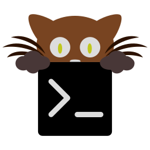
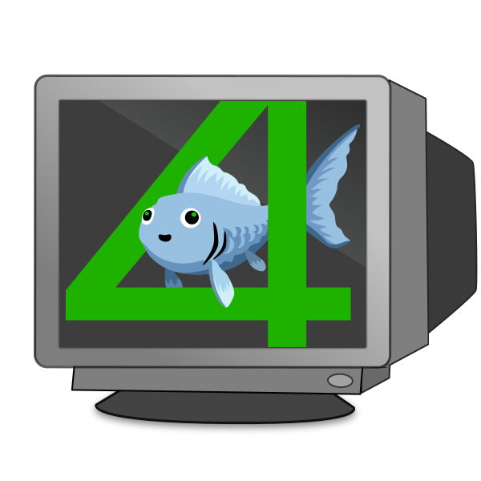

<div align="center">

&nbsp;&nbsp;&nbsp;
&nbsp;&nbsp;&nbsp;


# dms-personal-script

**From a fresh minimal Arch install to a themed MangoWM + Dux Shell desktop, in one command.**

[](https://archlinux.org)
[](https://wayland.freedesktop.org)
[](https://mangowm.github.io)
[](https://duxlabs.dev)
[](https://www.shellcheck.net)

[Quick start](#quick-start) •
[What you get](#what-you-get) •
[Before you start](#before-you-start) •
[After install](#after-install) •
[Customize](#customize) •
[Troubleshooting](#troubleshooting)

</div>

---

## Quick start

On a fresh Arch install ([set up like this](#before-you-start)), log in as your normal user and run:

```bash
curl -fsSL https://raw.githubusercontent.com/iancrowder23-ship-it/dms-personal-script/main/install.sh | bash
```

That's it. Enter your password when `sudo` asks, then reboot when it's done.

> [!TIP]
> Run the same line again any time. It updates the system, pulls the latest version of this repo, and installs only what's missing, so it also works as a **repair**.

<details>
<summary><b>Other ways to install</b></summary>

<br>

**Read it first, then run** (same result, nothing runs unread):

```bash
curl -fsSLO https://raw.githubusercontent.com/iancrowder23-ship-it/dms-personal-script/main/install.sh
less install.sh
bash install.sh
```

**From a git clone** (best if you want to edit the package lists):

```bash
sudo pacman -S --needed git
git clone https://github.com/iancrowder23-ship-it/dms-personal-script.git
cd dms-personal-script
./install.sh
```

</details>

---

## What you get

### Desktop

| | Component | Details |
|:-:|---|---|
|  | **MangoWM** | Lightweight Wayland compositor, config generated by Dux's own `dms setup` |
|  | **Dux Shell 2.0** | Bar, launcher, notifications, clipboard history, screenshots, night light, wallpaper-based colours, plus the matching Dux Greeter login screen |
|  | **kitty** | Terminal, set up by [fish-dotfiles](https://github.com/iancrowder23-ship-it/fish-dotfiles) |
|  | **fish** | Shell with Starship prompt, fastfetch and fisher plugins, also from fish-dotfiles |
|  | **Neovim** | Plus everything LazyVim needs: `lazygit`, `ripgrep`, `fd`, `fzf`, `tree-sitter-cli` |
|  | **LazyVim** | Official starter config in `~/.config/nvim` |
|  | **Dolphin** | File manager |

**Dark mode everywhere:** GTK, libadwaita, KDE/Qt and Flatpak apps all follow Dux's colours.
**Fonts:** Noto (incl. CJK and emoji), Liberation, DejaVu, JetBrains Mono Nerd Font.

### Apps (Flatpak)

| | App | Flathub ID |
|:-:|---|---|
|  | **Brave** | `com.brave.Browser` |
|  | **OBS Studio** | `com.obsproject.Studio` |
|  | **VLC** | `org.videolan.VLC` |
|  | **ONLYOFFICE** | `org.onlyoffice.desktopeditors` |
|  | **Warehouse** | `io.github.flattool.Warehouse` |

<details>
<summary><b>Full package lists</b></summary>

<br>

Everything is in plain text files, one name per line:

- [`packages/pacman.txt`](packages/pacman.txt): official repo packages
- [`packages/aur.txt`](packages/aur.txt): AUR packages (`dux-shell-git`, `dux-greeter-bin`)
- [`packages/flatpak.txt`](packages/flatpak.txt): Flathub app IDs

</details>

---

## How it works

```mermaid
flowchart LR
    A["curl | bash"] --> B["Bootstrap<br/>install git, clone repo"]
    B --> C["2 · Update<br/>pacman -Syu + paru"]
    C --> D["3 · Packages<br/>repo + AUR"]
    D --> E["4 · Dotfiles<br/>kitty, fish, LazyVim"]
    E --> F["5 · Dux Shell<br/>dms setup + systemd"]
    F --> G["6 · Flatpak<br/>apps + dark mode"]
    G --> H["7 · Home + system<br/>folders, timers"]
    H --> I["8 · Done<br/>wallpapers, next steps"]
```



| Phase | What happens |
|---|---|
| **Bootstrap** | Only under `curl \| bash`: installs git, clones this repo to `~/.local/share/dms-personal-script`, runs it from there |
| **2 · Update** | Full system upgrade, `git` + `base-devel`, builds `paru` from the AUR if missing |
| **3 · Packages** | Installs `pacman.txt` with pacman and `aur.txt` with paru |
| **4 · Dotfiles** | Runs the fish-dotfiles installer, links `environment.d` files, installs the LazyVim starter |
| **5 · Dux Shell** | `dms setup headless --compositor mango`, makes sure Dux starts with Mango (once), then `dms-greeter enable` for the login screen |
| **6 · Flatpak** | Adds Flathub (system-wide), installs the apps, lets Flatpaks read Dux's colours, sets dark mode |
| **7 · Home + system** | Creates Documents, Pictures, Music, Videos, etc., turns on pacman colour, and enables SSD trim, package-cache cleanup and pkgfile timers |
| **8 · Done** | Offers to download the [mylinuxforwork wallpaper pack](https://github.com/mylinuxforwork/wallpaper) into `~/Pictures/wallpaper`, then prints your next steps |

---

## Before you start

This script handles everything **after** `archinstall`. In archinstall, pick:

| Setting | Choose |
|---|---|
| **Profile** | `Minimal` |
| **Graphics driver** | The one for your GPU, if offered |
| **Network** | `NetworkManager` (Dux Shell uses it) |
| **Audio** | `PipeWire` |
| **User** | A normal user with `sudo` rights |
| **Firewall, Bluetooth, printing** | Whatever you need |

> [!IMPORTANT]
> Run the script as your **normal user**, not root. It calls `sudo` itself where needed, and the AUR helper refuses to run as root.

---

## After install

1. **Reboot.**
2. **Log in to Mango.** Dux Shell starts on its own.
3. **Set terminal colours:** open kitty and run
   ```fish
   theme-pick --dms
   ```
   so the terminal follows your wallpaper.
4. **Match the login screen to your theme:**
   ```bash
   dms-greeter sync
   ```
5. **Power and printing panels (optional):**
   ```bash
   sudo systemctl enable --now power-profiles-daemon cups
   ```

---

## Customize

All choices live in text files, not in the script. Lines starting with `#` are comments.

```bash
cd ~/.local/share/dms-personal-script     # or wherever you cloned it
nano packages/flatpak.txt                 # add e.g. com.discordapp.Discord
./install.sh --check                      # make sure every name exists
./install.sh                              # install what's new
```

| To add… | Edit | Find names at |
|---|---|---|
| A repo package | `packages/pacman.txt` | [archlinux.org/packages](https://archlinux.org/packages) |
| An AUR package | `packages/aur.txt` | [aur.archlinux.org](https://aur.archlinux.org) |
| A Flatpak app | `packages/flatpak.txt` | [flathub.org](https://flathub.org) |

### Check mode

```bash
./install.sh --check
```

Looks up every name in every list and installs nothing. If a package was renamed upstream, it tells you exactly which line to fix:

```text
==> Checking package names
  packages/pacman.txt (38 names)
  MISSING  packages/pacman.txt line 38: dolphn
  packages/aur.txt (2 names)
  packages/flatpak.txt (7 names)

1 name(s) not found. Fix the lines above (look the new name up on archlinux.org/packages, aur.archlinux.org or flathub.org).
```

---

## Built to survive updates

<details>
<summary><b>Why this keeps working as Arch and Dux change</b></summary>

<br>

- **Packages only**: everything comes from pacman, the AUR or Flathub. No hand-written build steps.
- **No pinned versions or download links**: only package names, so you always get the current release.
- **Names live in text files**: a rename upstream is a one-line edit, and `--check` points at the line.
- **Upstream setup commands**: Mango's config and Dux's service come from `dms setup` / `dms systemd`, not hand-written files.
- **Full upgrade every run**: Arch doesn't support partial upgrades, so the script never installs onto a stale system.
- **Safe to re-run**: every step checks first (`--needed`, `--if-not-exists`, existing folders), so a second run only fills gaps.
- **Never deletes your files**: anything in the way is renamed to `*.bak-<date>`.

</details>

---

## Troubleshooting

<details>
<summary><b>A package wasn't found / pacman 404s</b></summary>

<br>

Run `./install.sh --check`. A `MISSING` line means the package was renamed or removed: look it up and fix that line. 404 errors usually mean a stale mirror list, so try `sudo pacman -Syu` and run again.

</details>

<details>
<summary><b>paru stops to show PKGBUILDs</b></summary>

<br>

paru may ask you to review AUR build files. Press <kbd>q</kbd> to leave the viewer and confirm. Reviewing is a safety check for AUR packages.

</details>

<details>
<summary><b>Dux Shell doesn't start, or starts twice</b></summary>

<br>

```bash
dms systemd status        # should list mango-session.target
dms doctor                # checks Dux's dependencies
```

Don't add `dms run` to your Mango config; the systemd service already starts it.

</details>

<details>
<summary><b>An app is still light-themed</b></summary>

<br>

Make sure Dux is on its wallpaper (dynamic) theme, then log out and back in so `QT_QPA_PLATFORMTHEME=qt6ct` takes effect. For Flatpak apps, `flatpak override --user --show` should list the `gtk-3.0`, `gtk-4.0` and `kdeglobals` paths.

</details>

<details>
<summary><b>Where did my old configs go?</b></summary>

<br>

Nothing is deleted. Look for `~/.config/<name>.bak-<date>` folders and files.

</details>

---

## Repo layout

```text
dms-personal-script/
├── install.sh              the only script
├── packages/
│   ├── pacman.txt          official repo packages
│   ├── aur.txt             AUR packages
│   └── flatpak.txt         Flathub app IDs
├── dotfiles/
│   └── environment.d/      linked into ~/.config/environment.d/
├── assets/icons/           icons used in this README
├── PLAN.md                 build plan and design rules
└── ANSWERS.md              why each package was chosen
```

---

<div align="center">

Built on [MangoWM](https://mangowm.github.io) · [Dux Shell](https://github.com/duxlabs-dev/dux-shell) · [LazyVim](https://www.lazyvim.org) · [fish-dotfiles](https://github.com/iancrowder23-ship-it/fish-dotfiles)

<sub>Icons belong to their projects: from each app's Flathub listing, the upstream repos (MangoWM, Neovim, LazyVim, fish) and the installed Arch packages.</sub>

</div>
